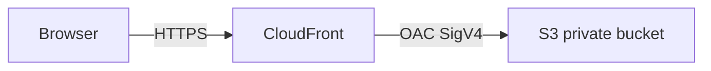

# ☁️ Resume Hosting on AWS — S3 + CloudFront

My first AWS cloud infrastructure project. A simple, serverless, and cost-effective way to host a PDF resume publicly on the internet using AWS managed services and Infrastructure as Code (IaC).

**Live:** https://d2ei9h2gh8lzqc.cloudfront.net

---

## 📐 Architecture



| Layer | Service | Role |
|---|---|---|
| Storage | Amazon S3 | Stores the PDF privately, encrypted with SSE-S3, with versioning |
| CDN | Amazon CloudFront | Delivers over HTTPS globally, including South America (`PriceClass_All`) |
| Security | Origin Access Control (OAC) | CloudFront-only access to S3; TLS required for every other caller |
| IaC | AWS CloudFormation | Reproducible infrastructure |

> The S3 bucket has **no public access**. Only CloudFront can read objects, and only through OAC. The bucket is **retained** if the stack is deleted, so the resume is not destroyed by accident.

The distribution forces `Content-Type: application/pdf` on every response. That is right while this site serves only the resume. An HTML landing page needs its own cache behavior; this headers policy would break HTML, CSS, and images.

---

## 🛠️ Stack

- **AWS S3** — object storage for the PDF, SSE-S3, versioning, block public access
- **AWS CloudFront** — global CDN with HTTPS, HTTP/2 and HTTP/3, IPv6, and response headers
- **AWS CloudFormation** — infrastructure defined as code (YAML)
- **AWS CLI** — deployment from PowerShell or bash

---

## 📁 Project Structure

```
resume-infra/
├── template.yaml    # CloudFormation template (S3 + CloudFront)
├── deploy.ps1       # Deployment script (PowerShell)
├── deploy.sh        # Deployment script (bash)
├── LICENSE          # MIT
└── README.md        # This file
```

---

## 🚀 How to Deploy

### Prerequisites
- [AWS CLI](https://docs.aws.amazon.com/cli/latest/userguide/install-cliv2.html) installed and configured
- An AWS account with permissions to create S3, CloudFront, and CloudFormation resources

### 1. Configure AWS credentials

```powershell
aws configure
```

### 2. Clone this repository

```powershell
git clone https://github.com/dalessicloud-a11y/resume-infra-cloud.git
cd resume-infra-cloud
```

### 3. Add your resume PDF

Put `resume.pdf` in the project folder, or pass another path. The bucket name defaults to `caio-dalessi-resume` on the first deploy. Pass another name if that one is already taken. An existing stack keeps its current bucket when you omit the name.

```powershell
.\deploy.ps1 -ResumeFile "C:\path\to\your\resume.pdf" -BucketName my-unique-bucket
```

```bash
./deploy.sh --resume-file /path/to/your/resume.pdf --bucket-name my-unique-bucket
```

### 4. Run the deployment script

```powershell
.\deploy.ps1
```

```bash
chmod +x deploy.sh
./deploy.sh
```

This will:
1. Deploy the CloudFormation stack (S3 bucket + CloudFront distribution)
2. Upload your PDF to the bucket name published in the stack outputs
3. Invalidate the CloudFront cache using the distribution ID (not the domain name)
4. Print the live CloudFront URL

> First deployment takes ~3 minutes. CloudFront propagation may add another 2-5 minutes.

`--skip-upload` / `-SkipUpload` deploys the stack and leaves the PDF untouched. `--force-upload` / `-ForceUpload` is accepted and does nothing extra: every deploy uploads the PDF unless you skip it.

---

## 🔄 Updating the Resume

Run the same script. It uploads the new PDF and creates a CloudFront invalidation. You do not need a stack change for a content update.

```powershell
.\deploy.ps1 -ResumeFile "C:\path\to\your\resume.pdf"
```

```bash
./deploy.sh --resume-file /path/to/your/resume.pdf
```

Viewers and CloudFront are told to cache the PDF for **5 minutes** (`Cache-Control: max-age=300`). Invalidation clears the CDN copy immediately. A browser that already opened the file can keep the previous copy until that 5 minutes is up.

To do the same steps by hand, read `BucketName` and `DistributionId` from the stack outputs. Do not guess the distribution ID from the `*.cloudfront.net` hostname: that prefix is not the ID. The invalidation API is in `us-east-1` even when the bucket is in another region.

```bash
BUCKET=$(aws cloudformation describe-stacks \
  --stack-name resume-stack \
  --region us-east-1 \
  --query "Stacks[0].Outputs[?OutputKey=='BucketName'].OutputValue" \
  --output text)
DIST=$(aws cloudformation describe-stacks \
  --stack-name resume-stack \
  --region us-east-1 \
  --query "Stacks[0].Outputs[?OutputKey=='DistributionId'].OutputValue" \
  --output text)

aws s3 cp resume.pdf "s3://${BUCKET}/resume.pdf" \
  --content-type "application/pdf" \
  --cache-control "max-age=300,public"

aws cloudfront create-invalidation \
  --distribution-id "$DIST" \
  --paths "/*" \
  --region us-east-1
```

---

## 🗑️ Deleting the stack

```bash
aws cloudformation delete-stack --stack-name resume-stack --region us-east-1
```

The bucket stays in the account (`DeletionPolicy: Retain`). CloudFormation cannot delete a bucket that still has objects, and deleting the stack should not delete the only copy of the resume. When you do want it gone, empty the bucket in the S3 console (include versions and delete markers) and then delete the bucket.

---

## 💰 Cost

This setup runs at effectively **$0/month** at personal traffic levels. Versioning keeps replaced PDFs for 30 days; one resume is nowhere near the free tier.

| Service | Free Tier | Typical cost |
|---|---|---|
| S3 | 5 GB storage, 20K GET requests/month | ~$0.00 |
| CloudFront | 1 TB transfer, 10M requests/month | ~$0.00 |
| CloudFormation | Free | $0.00 |

`PriceClass_All` is the default so visitors in Brazil are served from a South American edge. At this traffic it does not change the bill. Pass `-PriceClass PriceClass_100` or `--price-class PriceClass_100` to restrict edges to North America and Europe.

---

## 🔭 What I Learned

- How to create and configure an **S3 bucket** with public access blocked
- How **CloudFront OAC** (Origin Access Control) securely connects CloudFront to a private S3 bucket
- How to write a **CloudFormation template** to define cloud infrastructure as code
- How to set **response headers** in CloudFront to control browser behavior (inline PDF rendering)
- How to deploy and manage a stack using the **AWS CLI**

---

## 🗺️ Next Steps

- [ ] Add a custom domain with **Route 53** and **ACM** (the certificate must be in `us-east-1`)
- [ ] Build an HTML landing page to wrap the resume (and stop forcing `Content-Type: application/pdf` on every path)
- [ ] Add a CI/CD pipeline with **GitHub Actions** and OIDC to auto-deploy on push, without long-lived access keys
- [ ] Explore **AWS CDK** as an alternative to CloudFormation YAML

---

## 📄 License

MIT — feel free to use this as a template for your own resume hosting. See [LICENSE](LICENSE).
